

  

<h3 align="center">Photograph a laminate sample. Get the closest shades from the catalogue, with design numbers, in seconds.</h3>

> **This is a showcase.** The source code is private, and every screen, screenshot and video here uses **demo data** (144 generated swatches in four fictional catalogues). No real product data, customers or staff appear anywhere.

## Watch it

[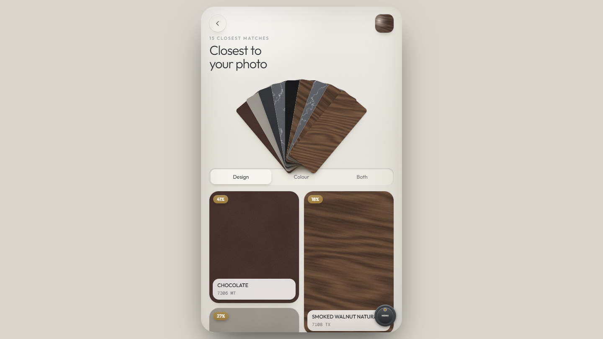](video/Mica-Match-tour.mp4)

**[Watch the tour (9 min, 1280x720)](video/Mica-Match-tour.mp4)**: the real app running end to end, chapter by chapter, from the brief to the numbers.

## Read it

- **[The journey](docs/JOURNEY.md):** the brief, the decisions (and the options rejected), the hard problems, the mistakes, and where it stands.
- **[Every feature](docs/FEATURES.md):** screen by screen, nothing left out.

## Screens

<table>
<tr>
<td width="50%">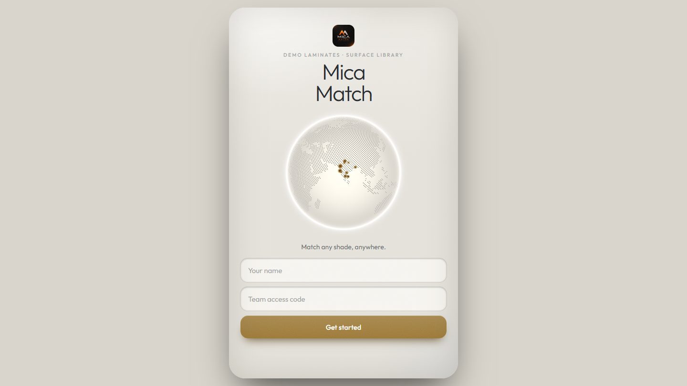 <b>Sign in with a name and the team's access code</b></td>
<td width="50%">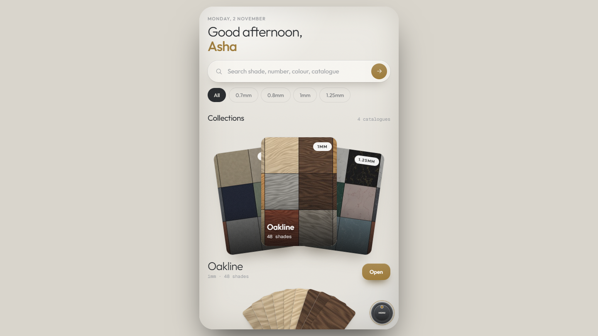 <b>The library: every catalogue is a book in the stack</b></td>
</tr>
<tr>
<td>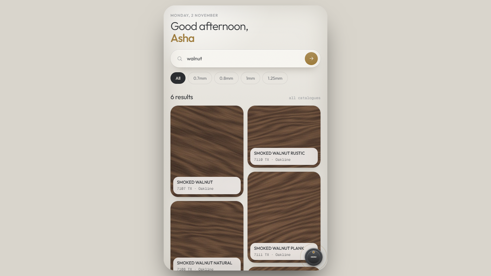 <b>One search box for names, design numbers and finishes</b></td>
<td>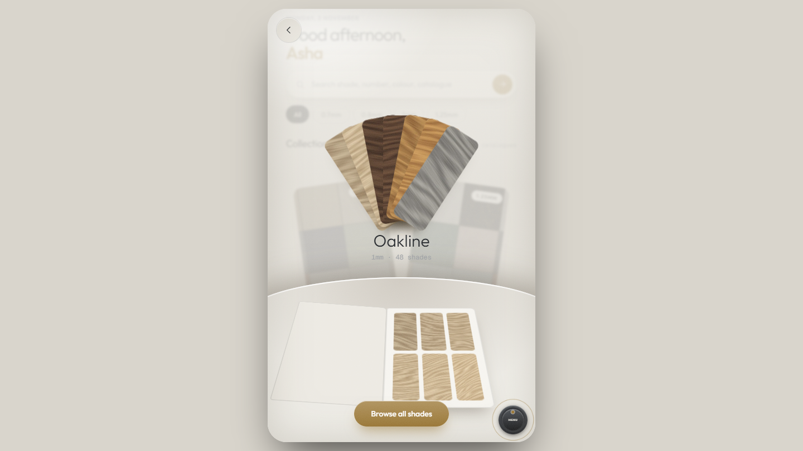 <b>Open a book: it lies on the table and fans out its shades</b></td>
</tr>
<tr>
<td>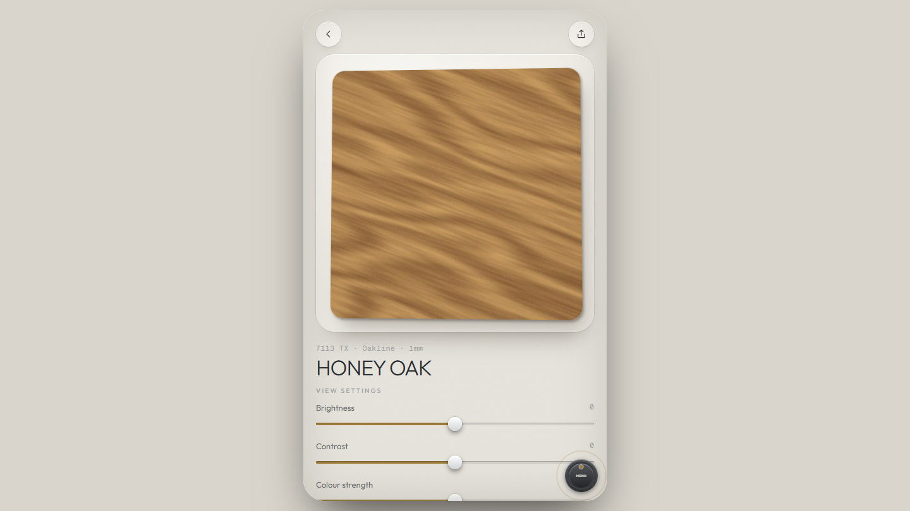 <b>Any shade, large, with light settings to preview it</b></td>
<td>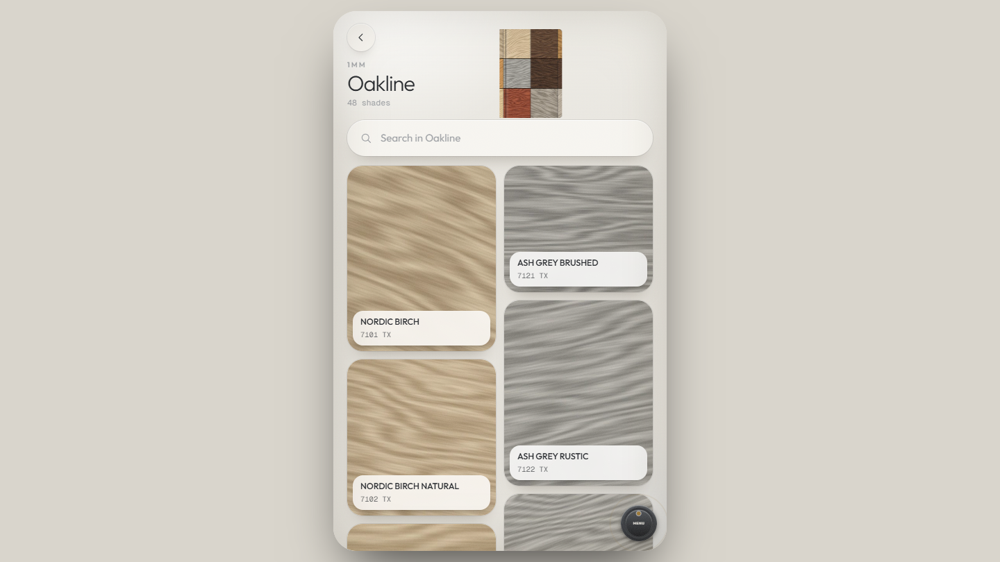 <b>The whole catalogue as a searchable wall</b></td>
</tr>
<tr>
<td>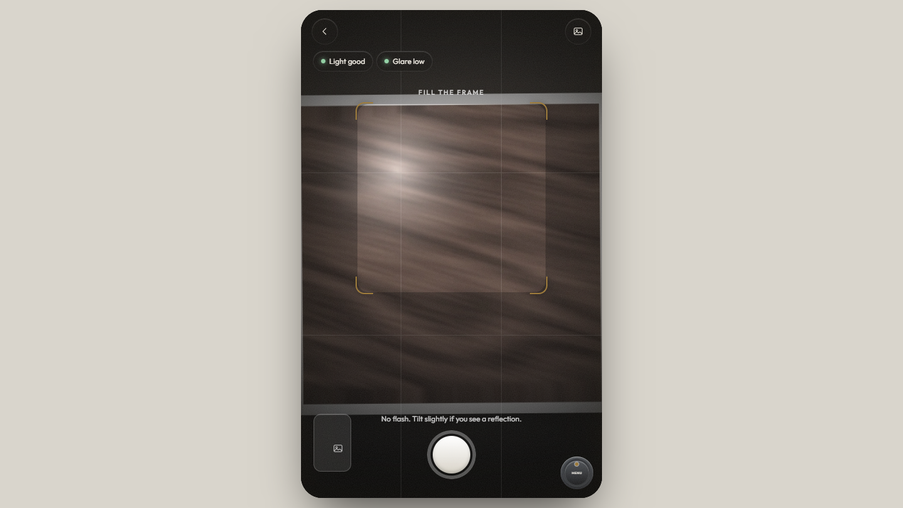 <b>Scan: live light and glare checks before the shot</b></td>
<td>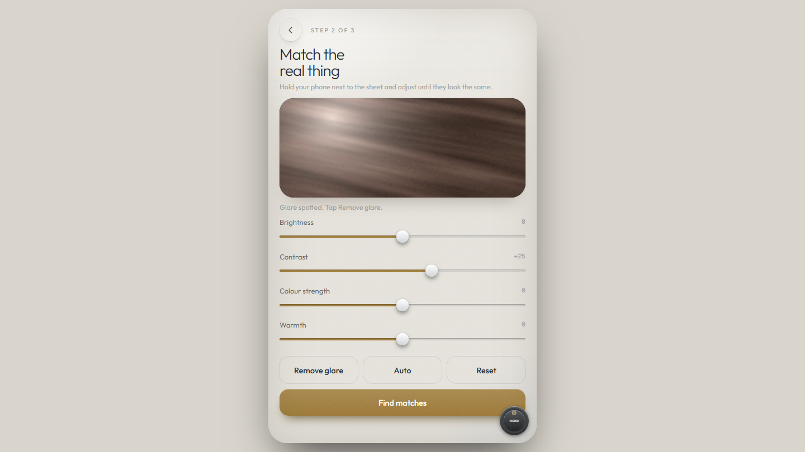 <b>Match the screen to the real sheet before searching</b></td>
</tr>
<tr>
<td> <b>The 15 closest shades, best first, with match scores</b></td>
<td>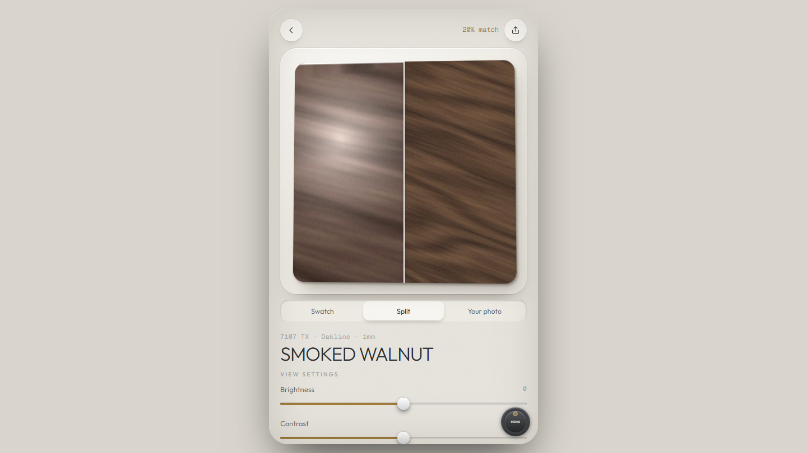 <b>Split view: the customer's photo beside the catalogue shade</b></td>
</tr>
<tr>
<td>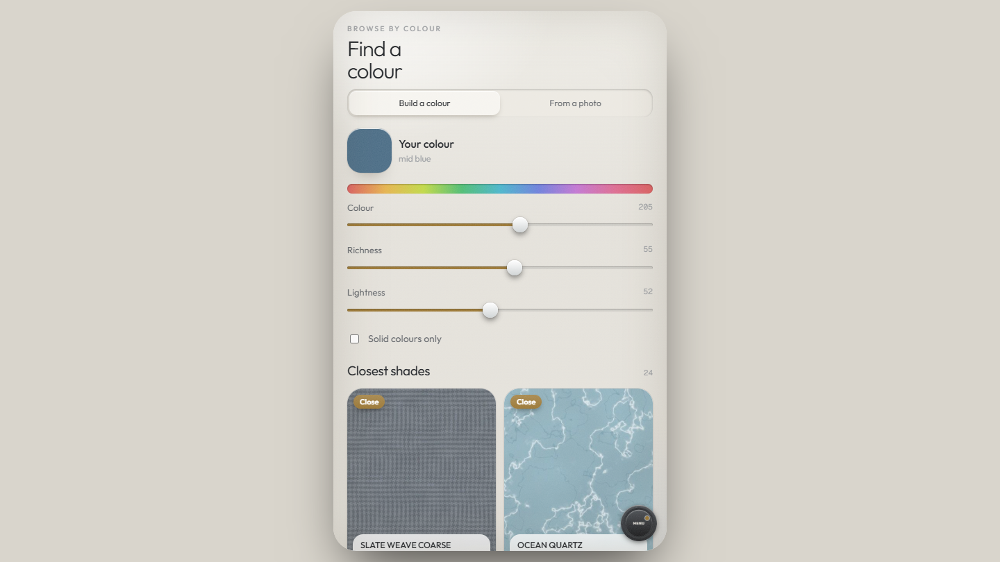 <b>Colour finder for customers who only know the colour</b></td>
<td>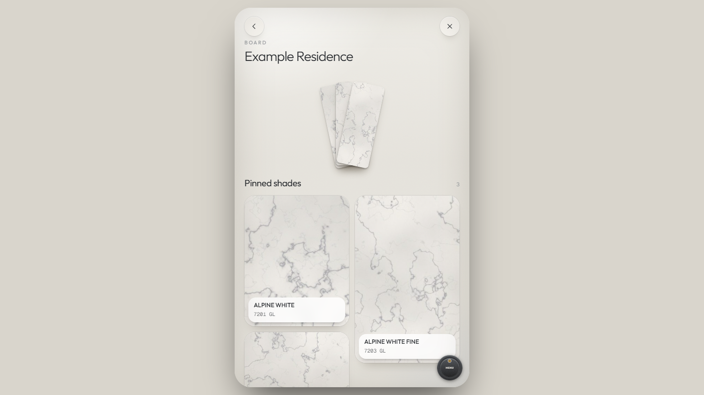 <b>Boards keep one customer's shortlist, photo and notes</b></td>
</tr>
<tr>
<td>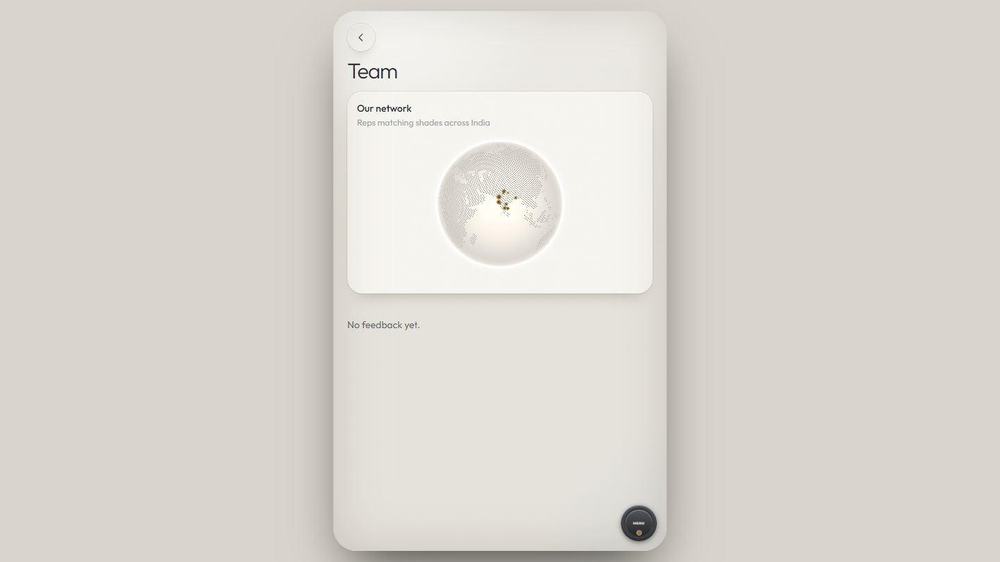 <b>Team page: who is teaching the app</b></td>
<td>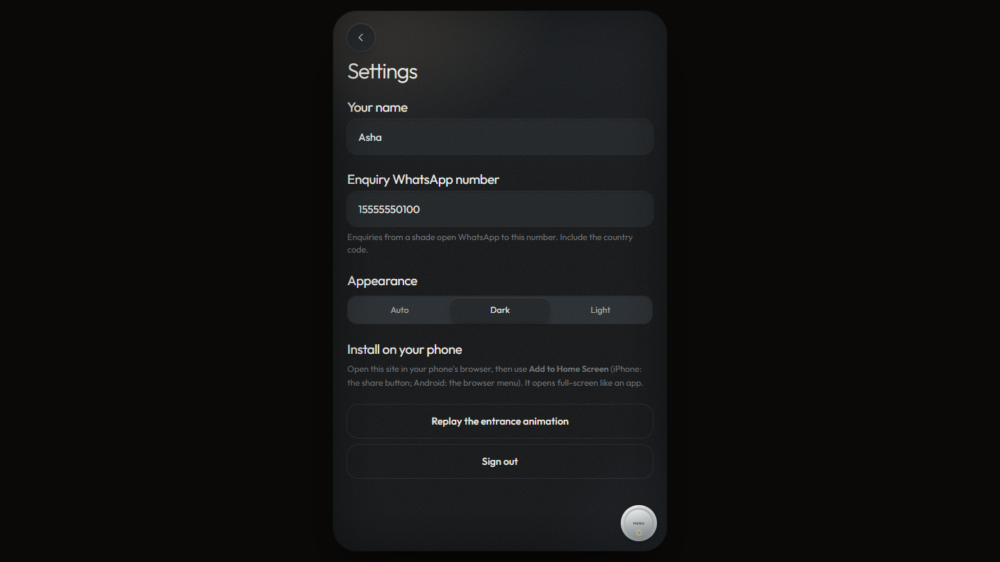 <b>Settings and the dark theme</b></td>
</tr>
</table>

## How it fits together

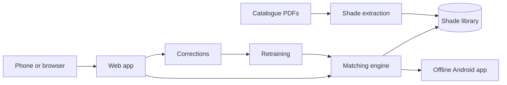

## Facts

| | |
|---|---|
| What | Photo-to-shade matching for laminate sales reps |
| Where it runs | iPhone and Android browsers, installable to the home screen, plus an offline Android app |
| Matching | A self-supervised vision model plus a small learned head; colour re-rank for phone colour bias |
| Accuracy (hard test set) | 67% right first, 93% in the top 5, 100% in the top 10 |
| Speed | About 0.5 seconds per photo, even on the phone itself with no network |
| Catalogue | 2,200+ shades across 23 catalogues in production (the demo shown here has 144 synthetic shades) |
| Status | Store closed test in progress |
| Source | Private |

---

Copyright © 2026 Khushal. All rights reserved.
